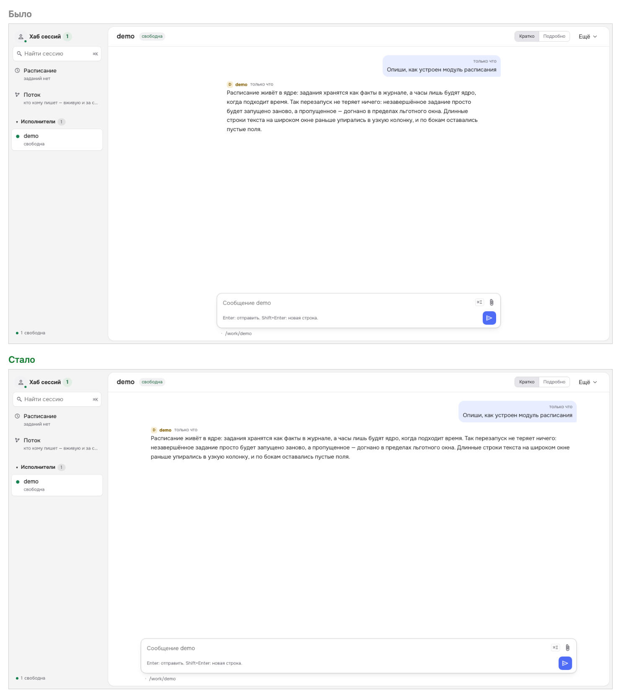

# wide-feed — широкая лента для Agents Hub

Плагин страницы хаба: лента сообщений и поле ввода занимают колонку до 1500 px вместо 800 px, а строка текста — до
125 знаков вместо 68. На большом окне по бокам больше нет пустых полей; на узком колонка по-прежнему на всю ширину,
с симметричными полями от 12 до 70 px.

## Как поставить

В Agents Hub: «Настройки» → «Плагины» → «Найти» → `wide-feed`.
Или хабу: «поставь плагин `Scremliss/hub-plugin-wide-feed`» (`hub market install Scremliss/hub-plugin-wide-feed`).
Выключить — там же, в «Плагинах».

## Что внутри

Только `main.js`: добавляет на страницу один `<style>` — ширину `.feed-inner` и `.dock-inner` и переменную `--measure`.
Ничего не читает, не отправляет и не вызывает хаб.

## Свои размеры

Откройте `main.js`: `1500px` — максимальная ширина колонки, `125ch` — длина строки, `70px` — боковое поле на широком окне.

Лицензия — MIT.
